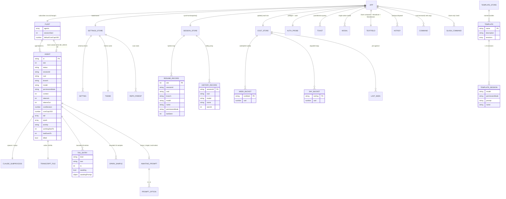
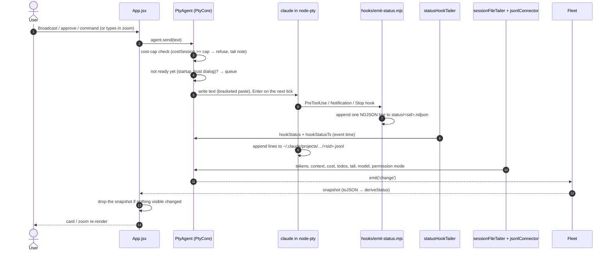
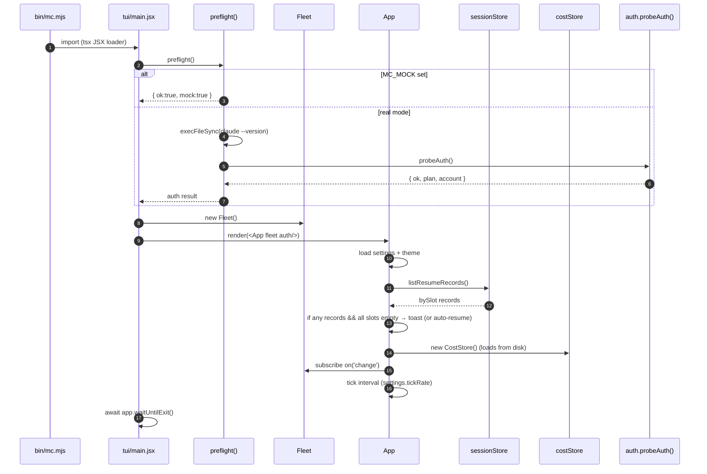

# ba-mission-control — Architecture & Entity Map

Generated 2026-06-09 by the systematic audit pass. Source of truth for
"what's actually in this repo, who calls what, where does state live."

**Updated 2026-10-08 (task 0467) for the PTY design.** Sections 1, 3, 6, 7
and 9 describe the default path: one interactive `claude` per slot in a
node-pty, with state read from the files claude writes. The stream-json
`Agent` is now the legacy path behind `FLEET_USE_PTY=0`. The ERD (§2) and the
state table (§5) still name `Agent`; read that as "the slot's agent object"
(`PtyAgent` by default). `server/zoomSession.mjs` was deleted in 0444.

Companion docs:
- `COMPONENTS.md` — per-component purpose, props, orphan flags
- `IMPROVEMENTS.md` — 500+ task backlog bucketed by category

---

## 1. Layered architecture

```
┌─────────────────────────────────────────────────────────────────┐
│ ENTRY                                                           │
│  bin/mc.mjs  → registers tsx loader → imports tui/main.jsx      │
└──────────────────────┬──────────────────────────────────────────┘
                       │
┌──────────────────────▼──────────────────────────────────────────┐
│ BOOT (tui/main.jsx)                                             │
│  preflight()  →  claude --version + claude auth status          │
│  new Fleet()                                                    │
│  render(<App fleet={fleet} auth={auth}/>)                       │
│  wire SIGINT/SIGTERM/SIGHUP → save open set, killAll, unmount,  │
│    SIGKILL stragglers after 1.5 s, release instance lock last   │
└──────────────────────┬──────────────────────────────────────────┘
                       │
┌──────────────────────▼──────────────────────────────────────────┐
│ UI LAYER  (Ink + React)                                         │
│  App.jsx (1389 LOC, 23 useState — REFACTOR CANDIDATE)           │
│    Header · Aggregate · Card[] grid · FleetLog · StatusBar      │
│    Modals: Zoom · NewSession · Settings · Help · Broadcast      │
│            · Dashboard · RepoPicker                             │
│  Shared: TextField · themes · format · models · slashCommands   │
└──────────────────────┬──────────────────────────────────────────┘
                       │ snapshot/event bus
┌──────────────────────▼──────────────────────────────────────────┐
│ DATA LAYER  (in-process, no HTTP)                               │
│  Fleet (10 slots default, 1–64; EventEmitter, snapshot)         │
│    one shared tick drives every slot's tailers                  │
│    PtyAgent[] (default) — extends PtyCore:                      │
│      PtyCore: node-pty spawn, xterm-headless emulator, send     │
│        queue, pause/resume/kill on the process tree, restart    │
│      sessionFileTailer + jsonlConnector — claude's JSONL        │
│      statusHookTailer — hook NDJSON (working/waiting/idle)      │
│      subagentUsageTailer — sub-agent usage into the parent      │
│      deriveStatus() — signals → one status + STUCK              │
│    CursorAgent — Cursor slots on the same PtyCore               │
│    Agent — legacy stream-json (FLEET_USE_PTY=0)                 │
│    MockAgent — replays fixture instead of spawning claude       │
└──────────────────────┬──────────────────────────────────────────┘
                       │
┌──────────────────────▼──────────────────────────────────────────┐
│ PERSISTENCE                                                     │
│  ~/.config/claude-mc/sessions.json   — bySlot + history         │
│  ~/.config/claude-mc/settings.json   — user preferences         │
│  ~/.config/claude-mc/costs-week.json — week/day cost buckets    │
│  ~/.config/claude-mc/templates.json  — named session bundles    │
│  ~/.local/state/claude-mc/status/<sid>.ndjson — hook events     │
│  ~/.claude/projects/<cwd>/<sid>.jsonl — claude's transcript     │
│  ~/.claude/abtop-rate-limits.json    — plan usage (claude-side) │
└─────────────────────────────────────────────────────────────────┘
```

---

## 2. Entity-relationship diagram (ERD)



---

## 3. Message flow: user sends a message → claude reply renders

Default PTY path. The message goes in as typed bytes; the reply comes back
through the files claude writes, not through stdout.



In zoom, `PtyPane` draws the agent's own emulator and sends keys through
`agent.writeInput()`, which applies the same cost-cap check. Zoom never
starts a claude of its own.

---

## 4. Boot sequence



---

## 5. State ownership boundaries

| Owner | State | Lives in | Persisted | Notes |
|-------|-------|----------|-----------|-------|
| Fleet | `agents[]`, `sessionStart`, `defaultCostCapUSD` | server/fleet.mjs in-memory | no | Lost on restart; restored by SessionStore |
| Agent (PtyAgent by default) | pty, emulator, send queue, tail, spark, signals, tokens, cost | server/ptyCore.mjs + server/ptyAgent.mjs in-memory | no — rebuilt from claude's JSONL on resume | Dies with the process |
| Paused-pid record | {pid, startTime} of paused slots | tui/lib/pausedPids.js | next to sessions.json | Next boot ends a paused claude left under pid 1 |
| Instance lock | pid of the mc that owns the config dir | tui/lib/instanceLock.js | `mc.lock` in the config dir | A second mc runs read-only |
| App | UI focus, modal, toasts, command-bar buffer, kill/quit-arm refs | tui/App.jsx React state | no | Per-session UI; resets on relaunch |
| SessionStore | bySlot map + rolling history | tui/lib/sessionStore.js | `~/.config/claude-mc/sessions.json` | Schema v2; trimmed at `settings.sessionHistoryLimit` |
| CostStore | week/day buckets + per-agent lastSeen | tui/lib/costStore.js | `~/.config/claude-mc/costs-week.json` | Rolls over Monday 00:00 UTC |
| SettingsStore | user preferences | tui/lib/settings.js | `~/.config/claude-mc/settings.json` | Schema-driven via SETTINGS_SCHEMA |
| TemplateStore | named session bundles | tui/lib/templateStore.js | `~/.config/claude-mc/templates.json` | Bundled defaults; user-extensible |

---

## 6. Event bus

| Emitter | Event | Triggered by | Payload | Listeners |
|---------|-------|--------------|---------|-----------|
| Agent | `'change'` | tailer reads (JSONL, hook NDJSON, sub-agent files), state transitions, send, pause, resume, kill | (none — snapshot pulled on demand) | Fleet |
| Fleet | `'change'` | any Agent `'change'`, plus launch/kill/setCostCap | `{ sessionStart, now, agents: [...] }` snapshot | App.jsx (single subscriber) |
| Node | `'SIGINT' \| 'SIGTERM' \| 'SIGHUP'` | OS (Ctrl-C, kill, terminal closed) | — | main.jsx shutdown handler (saves; only the in-app `[d]` discards) |
| Node | `'SIGCONT'` | OS | — | main.jsx re-enters the alt screen; App forces a full redraw |
| stdout | `'resize'` | TTY SIGWINCH | — | App.jsx termSize tracker |

---

## 7. Subprocess boundary

### Default: interactive claude in a PTY (`PtyAgent`)

`PtyAgent` spawns the interactive `claude` in a node-pty:

```
claude
  --session-id <uuid>        ← new session (or --resume <uuid> when a transcript exists)
  [--model <cli id>]
  [--permission-mode <mode>]
  --add-dir <cwd>
  --settings '<hooks JSON>'  ← wires Notification / PreToolUse / Stop to hooks/emit-status.mjs
```

The child env is mc's env minus the parent claude's session markers
(`childEnv()` in `ptyCore.mjs`, 0469), so mc run from inside claude still gets
transcripts.

**Inbound:** nothing is parsed from the PTY output except screen checks
(approval prompt, active-turn spinner, folder-trust dialog). Data comes from:
- `~/.claude/projects/<encoded-cwd>/<sid>.jsonl` — claude's transcript, read by
  `sessionFileTailer`, parsed by `jsonlConnector`
- `~/.local/state/claude-mc/status/<sid>.ndjson` — hook events, read by
  `statusHookTailer`
- `<sid>/subagents/**/agent-*.jsonl` — sub-agent usage, read by
  `subagentUsageTailer`

**Outbound:** text written to the PTY (bracketed paste when claude has it on),
then Enter on a later tick. Queued messages go one at a time.

**Lifecycle signals** (to claude's process group and every descendant):
- `SIGSTOP` / `SIGCONT` — pause/resume
- `SIGTERM`, then `SIGKILL` after 1.5 s — kill, restart, quit
- PTY exit → auto-restart with backoff unless killed; a respawn waits for the
  old claude to exit

### Legacy: stream-json (`Agent`, `FLEET_USE_PTY=0`)

`Agent.start()` spawns `claude --print --input-format stream-json
--output-format stream-json --include-partial-messages …` and parses
newline-delimited JSON from stdout (`system` init, `stream_event` deltas,
`assistant`, `user`, `result` with `total_cost_usd`). Input is one JSON
`{ "type":"user", "message": {…} }` line per message. Zoom does not work on
this path.

---

## 8. Data-flow critical paths (high-traffic)

| Path | Hops | Frequency | Risk |
|------|------|-----------|------|
| Token stream → UI | claude → Agent#handle → Agent.emit → Fleet.emit → App.setSnapshot → React render | 50ms throttle (up to 20Hz) | Re-render storm if useMemo deps unstable (see IMPROVEMENTS) |
| User message → claude | TextField → Zoom → App.sendOne → Agent.send → proc.stdin | per Enter | Sync stdin.write blocks event loop if buffer full |
| Persist sessions | App.useEffect([snapshot]) → syncFromSnapshot → fs.writeFileSync | per snapshot | Silent persist failure = data loss |
| Cost tracking | App.useEffect([snapshot]) → CostStore.update → fs.writeFileSync | per snapshot | Same silent-failure pattern |
| Resize | TTY → stdout.on('resize') → setTermSize → re-layout | rare | Card width recomputation in render path |
| Auth probe | preflight (boot) + `:auth` verb | rare | execFileSync blocks boot ~3s on slow CLI |

---

## 9. File-system contract

| Path | Owner | Lifecycle | Failure mode today |
|------|-------|-----------|--------------------|
| `~/.config/claude-mc/sessions.json` | SessionStore | created on first sync; never deleted | Silent reset to empty on parse error → data loss |
| `~/.config/claude-mc/settings.json` | SettingsStore | created on first save; merges with defaults on load | Silent fallback to defaults on parse error |
| `~/.config/claude-mc/costs-week.json` | CostStore | created on first update | Silent reset on parse error → cost-tracking loss |
| `~/.config/claude-mc/templates.json` | TemplateStore | optional; bundled defaults if missing | Silently ignored on parse error |
| `~/.config/claude-mc/debug-keys.log` | TextField (`MC_DEBUG_KEYS=1` only) | append-only diagnostic | Silent open-fail if dir missing — TODO(debug-keys-mkdir) |
| `~/.local/state/claude-mc/status/<sid>.ndjson` | hooks/emit-status.mjs (writes), statusHookTailer (reads) | one line per hook event; `MC_STATUS_DIR` overrides the dir | Hook always exits 0; a write failure loses that event |
| `~/.claude/projects/<encoded-cwd>/<sid>.jsonl` | external (claude CLI) | written by claude; read by the tailers | Tailer polls for creation until the first message |
| `~/.config/claude-mc/mc.lock` | instanceLock | created with `wx` at boot, released last at exit | A live holder makes the second mc read-only |
| paused-pid record (config dir) | pausedPids | written when the paused set changes | Next boot signals only a pid whose start time and parent still match |
| `~/.local/state/claude-mc/sessions/<id>.jsonl` | legacy Agent transcript (`FLEET_USE_PTY=0` only) | created on first send | Silent fail if FS read-only |
| `~/.claude/abtop-rate-limits.json` | external (claude CLI) | best-effort read | UI gracefully degrades when missing |

---

## 10. Trust boundaries (security map)

```
EXTERNAL TRUST                           ←  not trusted
  process.env (CLAUDE_BIN, ANTHROPIC_API_KEY, MC_MOCK, MC_DEBUG_KEYS)
  user input (composer, command bar, settings)
  filesystem (templates, settings — user can edit between launches)
                ↓
INTERNAL TRUST                           ←  trusted after validation
  Fleet, Agent, stores
                ↓
SUBPROCESS SURFACE                       ←  inherits full env today (gap)
  claude CLI                             ←  treated as cooperative
  git CLI                                ←  treated as cooperative
```

**Today's gaps** (covered in IMPROVEMENTS.md → SECURITY):
- `env: process.env` spread to spawn — no allowlist filtering
- `listMentionTargets()` does not enforce cwd containment
- `listRecentRepos()` does not resolve symlinks before parent-check
- `:slack <url>` does not validate domain
- Auth fallback to `ANTHROPIC_API_KEY` env leaks into summary

---

## 11. What this map is NOT

- Not a runtime-behavior spec — see in-code comments + tests for behavior contracts
- Not a release plan — see IMPROVEMENTS.md for prioritized backlog
- Not exhaustive on the React render tree — see COMPONENTS.md for the per-component matrix
- Not a substitute for reading `server/agent.mjs` before touching subprocess code
